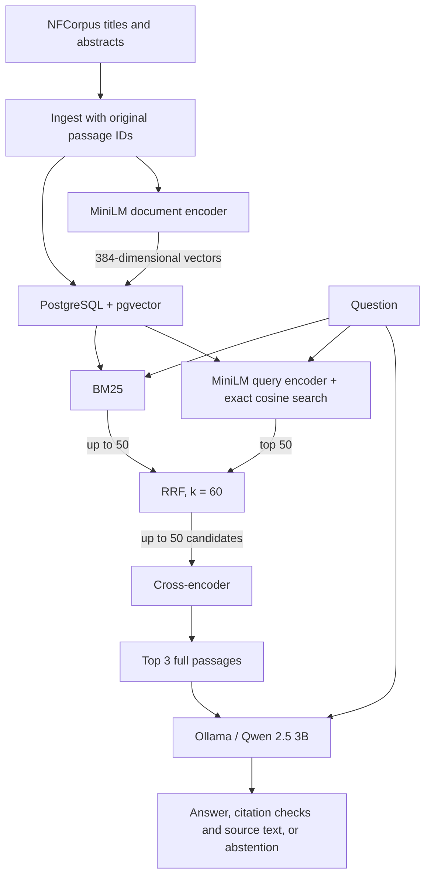

# Advanced RAG with Hybrid Retrieval & Reranking

A local command-line question answering system for 3,633 NFCorpus abstracts. BM25 finds passages with matching terms, while dense retrieval can find related wording. Reciprocal Rank Fusion (RRF) combines their rankings. A cross-encoder reads each candidate alongside the question to decide which three passages a local LLM should see.

On the 323 official test queries, hybrid search achieved **0.157406 Recall@10**, compared with **0.139723** for dense search and **0.152153** for BM25. Reranking increased hybrid **MRR@10 from 0.541119 to 0.585518**. [Test rankings](results/phase_6_test.csv)

## System architecture



## Technology stack and features

| Component | Implementation |
| --- | --- |
| Storage | Docker Compose runs PostgreSQL 16 with pgvector 0.8.1. Each row holds the original ID, title, abstract and vector. Python connects through Psycopg. |
| Retrieval | `rank_bm25.BM25Okapi` uses lowercase word tokens. Sentence Transformers encodes titles and abstracts with `sentence-transformers/multi-qa-MiniLM-L6-cos-v1`. PostgreSQL orders rows by cosine distance. |
| Fusion and reranking | RRF adds `1 / (60 + rank)` for each list containing a passage. `cross-encoder/ms-marco-MiniLM-L6-v2` scores question–passage pairs. Search results expose the component ranks. |
| Generation | Local Ollama runs `qwen2.5:3b`. The CLI returns the raw answer, cited IDs, validation status and complete evidence. It supports an explicit insufficient-evidence response. |
| Evaluation | Python 3.11, PyTorch and pytest. The evaluator saves four rankings per query. A separate command replays scoring using just the rankings and judgments. |

## Dataset and held-out results

The pinned BEIR distribution of NFCorpus contains 3,633 documents and 3,237 queries. Its official splits contain 2,590 train, 324 development and 323 test queries. Each title and abstract stays together as one retrievable, citable passage. The download command checks all five files against pinned SHA-256 hashes. [NFCorpus dataset](https://huggingface.co/datasets/BeIR/nfcorpus) · [Pinned inputs](rag/download.py)

| Pipeline | Recall@10 | MRR@10 | Recall@50 |
| --- | ---: | ---: | ---: |
| BM25 | 0.152153 | 0.508971 | 0.210408 |
| Dense | 0.139723 | 0.488367 | 0.220793 |
| Hybrid RRF | 0.157406 | 0.541119 | 0.238869 |
| Hybrid + reranking | **0.161421** | **0.585518** | **0.238869** |

All four methods used the same 323 test queries and positive judgments (grade > 0). Recall measures the fraction of a query's judged-relevant passages found by the cutoff. MRR averages the reciprocal rank of the first relevant hit. Queries with no hits contribute zero. Reranking reordered exactly the same 50 IDs for every test query, explaining the equal Recall@50. On the separate development split, hybrid and reranked Recall@10 were 0.129586 and 0.151834. [Test rankings](results/phase_6_test.csv) · [Development rankings](results/phase_4_dev.csv)

## Install on Windows

1. Install Python 3.11 and start Docker Desktop with Linux containers. Open PowerShell in the project root. [Docker Desktop for Windows](https://docs.docker.com/desktop/setup/install/windows-install/)
2. Create the environment and initialize the local password file. Keep the same password file when reusing an existing database volume.

```powershell
py -3.11 -m venv .venv
$py = '.\.venv\Scripts\python.exe'
& $py -m pip install -r requirements.txt
if (-not (Test-Path -LiteralPath '.env.db-password')) {
    [IO.File]::WriteAllText((Join-Path $PWD '.env.db-password'), [guid]::NewGuid().ToString('N'))
}
docker compose up -d --wait db
```

3. Load and verify the corpus, then build the embeddings. The first model run needs internet access. Embedding commits each batch and resumes from missing vectors. The default database is `rag` on `127.0.0.1:5433`.

```powershell
$env:RAG_DENSE_DEVICE = 'cpu'
$env:OMP_NUM_THREADS = '4'
& $py -X utf8 -m rag download
& $py -X utf8 -m rag ingest
& $py -X utf8 -m rag verify
& $py -X utf8 -m rag embed --batch-size 16
```

4. For `ask`, install and launch Ollama for Windows. The Windows app serves requests locally. With the standalone CLI, run `ollama serve` in a separate PowerShell window. Download the QA model once. [Ollama for Windows](https://docs.ollama.com/windows)

```powershell
ollama pull qwen2.5:3b
ollama list
```

## Usage

Run these commands in the same PowerShell session. In a new session set `$py = '.\.venv\Scripts\python.exe'` again. The first reranked search downloads the pinned cross-encoder.

```powershell
$q = "How many first- and sixth-graders participated in the 'Split them!' cookie-size study at afternoon tea?"
& $py -X utf8 -m rag search bm25 $q --limit 3
& $py -X utf8 -m rag search dense $q --limit 3
& $py -X utf8 -m rag search hybrid $q --limit 3
& $py -X utf8 -m rag search reranked $q --limit 3
& $py -X utf8 -m rag ask $q
```

For this question, `MED-3376` ranked first in BM25, dense retrieval, RRF and reranking. Its methods section reports 77 participants. The question asking for the exact clock time of afternoon tea elicited the abstention. Both demonstrations include the passages supplied to Qwen. [Recorded CLI outputs](results/phase_6_qa.json)

```powershell
# Recompute the published test table without running inference or starting a database.
& $py -X utf8 -m rag score-rankings test results/phase_6_test.csv
& $py -X utf8 -m rag score-rankings dev results/phase_4_dev.csv

# Run all four methods from the database and save a separate ranking file.
& $py -X utf8 -m rag evaluate-test --save-rankings "$env:TEMP\nfcorpus-test.csv"

# Include the live retrieval and reranking tests against the populated database.
$env:RAG_LIVE_TESTS = '1'
& $py -X utf8 -m pytest -q
```

The published retrieval run used CPU dense embeddings and a CUDA 12.6 build of PyTorch 2.9.1 for cross-encoding on an RTX 3050 Laptop GPU. CPU-only evaluation is supported. Hardware or library differences can change nearly tied scores.

To match the measured device placement on a compatible NVIDIA system, install the CUDA wheel in the project environment before running `evaluate-test`. Check that the second value printed is `True`.

```powershell
& $py -m pip install --no-deps --index-url https://download.pytorch.org/whl/cu126 "torch==2.9.1+cu126"
$env:RAG_DENSE_DEVICE = 'cpu'
$env:OMP_NUM_THREADS = '4'
& $py -c "import torch; print(torch.__version__, torch.cuda.is_available())"
```

## Project structure

```text
rag/              CLI, dataset loading, retrieval, fusion, reranking, QA and evaluation
tests/            Unit, database and live retrieval checks
examples/         Labeled QA examples and comparison drivers
results/          Ranked IDs, QA transcripts and manual grounding checks
compose.yaml      PostgreSQL and pgvector service
requirements.txt  Pinned Python dependencies
```

## Limitations

- The cross-encoder can promote only passages already in the fused candidate set. Its 512-token scoring window can truncate long inputs. Generation receives the selected passages' full text.
- Citation validation detects IDs outside the supplied context and flags missing or malformed citations. Factual support still requires reading the cited source.
- Qwen can falsely abstain even when the first passage contains the answer. On five fresh answerable examples it gave three correct cited answers and two false abstentions. These hand-written checks complement the retrieval benchmark. [Manual QA review](results/phase_5_refinement_review.csv)
